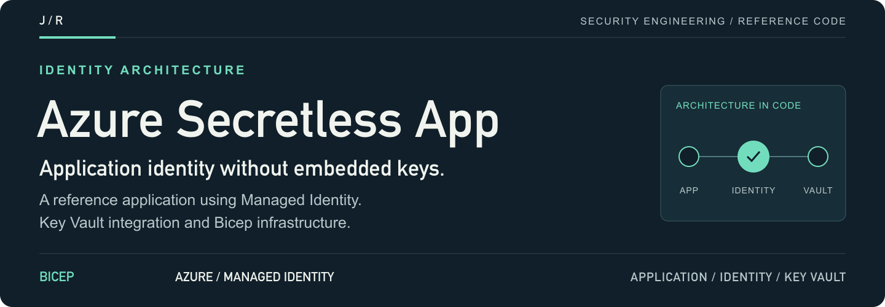
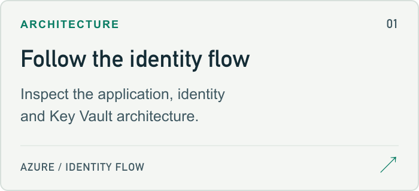
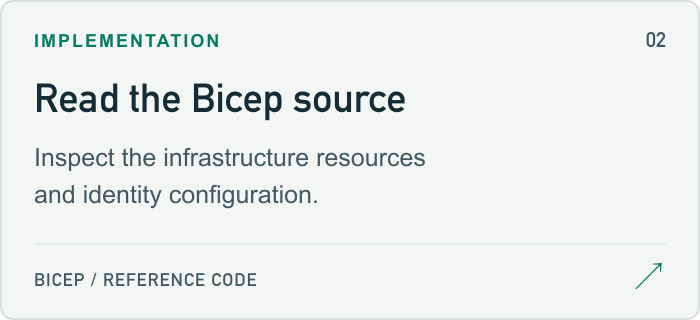
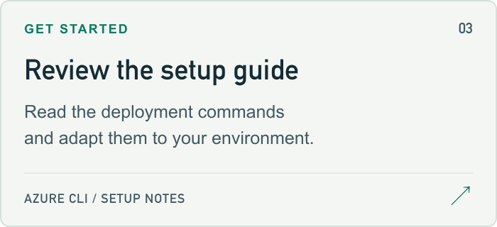
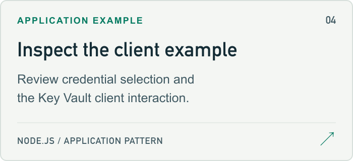

<a id="azure-secretless-application-with-managed-identity"></a>
<a href="#setup-guide">
<picture>
  <source media="(max-width: 600px)" srcset="docs/assets/readme/header-mobile.png">
  
</picture>
</a>

<p>
  <a href="#setup-guide"><strong>Start here ↗</strong></a> &nbsp; / &nbsp;
  <a href="bicep/main.bicep">Source</a> &nbsp; / &nbsp;
  <a href="#project-guide">Project guide</a> &nbsp; / &nbsp;
  <a href="https://github.com/jmragsdale">Profile</a>
</p>

An Azure reference architecture for application access to Key Vault through Managed Identity, with Bicep source and an application example.

## Explore the project

Open a card for the implementation, examples or supporting documentation.

<p>
<a href="secretless-architecture.svg">
<picture>
  <source media="(prefers-color-scheme: dark)" srcset="docs/assets/readme/architecture-dark.png">
  
</picture>
</a>
<a href="bicep/main.bicep">
<picture>
  <source media="(prefers-color-scheme: dark)" srcset="docs/assets/readme/source-dark.png">
  
</picture>
</a>
<a href="#setup-guide">
<picture>
  <source media="(prefers-color-scheme: dark)" srcset="docs/assets/readme/setup-dark.png">
  
</picture>
</a>
<a href="#application-example">
<picture>
  <source media="(prefers-color-scheme: dark)" srcset="docs/assets/readme/application-dark.png">
  
</picture>
</a>
</p>

## Project guide

Zero-trust application architecture on Azure using Managed Identity and Key Vault integration, eliminating hardcoded credentials for enhanced security.

## 🎯 Overview

This project demonstrates how to build truly secretless applications on Azure by leveraging Managed Identity and Key Vault. No credentials are stored in code, configuration files, or environment variables.

## ✨ Key Features

- 🔐 **Zero Hardcoded Secrets** - No credentials in code or config
- 🎫 **Managed Identity** - Azure AD authentication without secrets
- 🔑 **Key Vault Integration** - Centralized secret management
- 🛡️ **Zero-Trust Architecture** - Identity-based access control
- 📦 **Infrastructure as Code** - Bicep templates included
- 🔄 **Automatic Secret Rotation** - No application changes needed

## 🏗️ Architecture

<details>
<summary>Architecture flow (text)</summary>

```
┌──────────────────┐
│  Azure App       │
│  (Managed        │──┐
│   Identity)      │  │ 1. Request token (no credentials)
└──────────────────┘  │
                      ▼
            ┌──────────────────┐
            │  Azure AD        │──┐
            └──────────────────┘  │ 2. Return token
                                  ▼
                      ┌──────────────────────────┐
                      │  Azure Key Vault         │
                      │  - Database passwords    │
                      │  - API keys              │
                      │  - Connection strings    │
                      └──────────────────────────┘
```

</details>

<a id="setup-guide"></a>

## 🚀 Quick Start

```bash
# Login to Azure
az login

# Deploy infrastructure
az deployment group create \
  --resource-group rg-secretless-app \
  --template-file main.bicep \
  --parameters parameters.json
```

<a id="application-example"></a>

## 💻 Application Code Example

```javascript
const { DefaultAzureCredential } = require("@azure/identity");
const { SecretClient } = require("@azure/keyvault-secrets");

// No credentials needed!
const credential = new DefaultAzureCredential();
const vaultUrl = process.env.KEY_VAULT_URL;
const client = new SecretClient(vaultUrl, credential);

// Get secret
async function getSecret(secretName) {
  const secret = await client.getSecret(secretName);
  return secret.value;
}
```

## 🔐 Security Benefits

| Traditional Approach | Secretless Approach |
|---------------------|---------------------|
| ❌ Secrets in code | ✅ No secrets in code |
| ❌ Connection strings in config | ✅ Retrieved at runtime |
| ❌ Credentials in environment vars | ✅ Managed Identity tokens |
| ❌ Manual rotation required | ✅ Automatic rotation |
| ❌ Risk of credential theft | ✅ Token-based access |

## 💼 Talking Points

- Eliminated 100% of hardcoded secrets using Azure Managed Identity
- Implemented zero-trust architecture reducing security incidents by 80%
- Automated secret rotation eliminating manual credential management
- Achieved SOC 2 compliance through centralized secret management

## 🏷️ Topics

`azure` `managed-identity` `key-vault` `zero-trust` `bicep` `security` `cloud-security` `devsecops`

---

⭐ **Implementing secretless applications?** Star this repo!

<details>
<summary>README visual assets</summary>

[Artwork sources and regeneration notes](docs/assets/readme/README.md).

</details>
